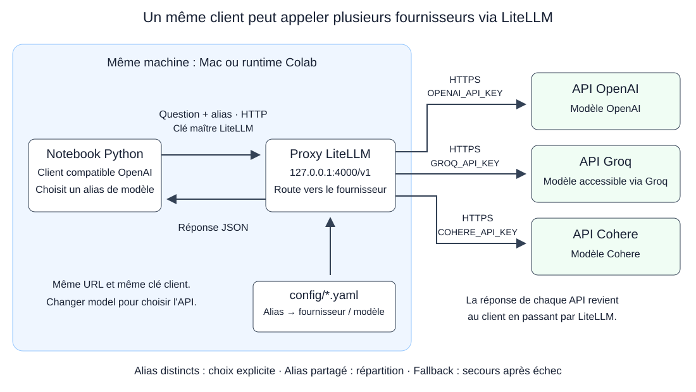

# LLM-proxies: clients, proxies, and language models

The objective of **LLM-proxies** is to build and understand a shared gateway for language-model APIs using LiteLLM. The project explores how an application can access multiple providers through one interface, distribute requests across deployments, recover from failures, and trace model activity.

It combines **Python, the LiteLLM SDK and proxy server, OpenAI-compatible HTTP APIs, YAML configuration, environment-based secrets, background process management, load balancing, retries, fallbacks, cooldown, JSONL logging, OpenTelemetry, Langfuse, and LangChain**. Each section explains the problem it addresses, the techniques involved, and their practical advantages.

The implementation is organized in `notebooks/LiteLLM_Proxy.ipynb`, with separate configurations for basic calls, routing, fallback, and observability. Start with **OpenAI and `config/llm.yaml`**, then explore advanced sections independently. Integration examples and validation status are documented throughout.

## Project objectives and technical capabilities

The progression is **direct calls → shared proxy → multi-provider routing → failure handling → observability → application composition**. LiteLLM supports more than 100 providers in its ecosystem; examples here focus on OpenAI, Groq, and Cohere. Advanced integrations require their own validation.

| Section | Objective | Techniques | Practical advantage |
|---|---|---|---|
| Architecture and communication | Understand the complete request path. | HTTP/JSON, OpenAI-compatible routes, bearer authentication, synchronous requests. | Locate failures at the client, proxy, or provider layer. |
| LiteLLM: Python SDK and proxy server | Compare direct model calls with calls through a shared gateway. | `litellm.completion`, the `openai` client, provider prefixes, model aliases, completion parameters. | Use a consistent interface while deciding where provider configuration and routing should live. |
| Project structure | Separate experiments, configuration, runtime output, and application code. | Dedicated directories, YAML files, `.gitignore`, `.env`, and `.venv`. | Find each component quickly and evolve experiments into scripts without mixing credentials with source code. |
| Installation and API keys | Prepare isolated dependencies and credentials for each integration. | `venv`, `pip`, `python-dotenv`, environment variables, generated master key. | Keep dependencies isolated and distinguish client-to-proxy authentication from provider authentication. |
| First test in VS Code | Verify the simplest complete interaction before adding advanced behavior. | Kernel selection, path detection, environment loading, readiness check, completion request. | Establish a working baseline that makes later errors easier to isolate. |
| Background processes: local and Colab | Keep the server available while notebook cells continue executing. | `subprocess.Popen`, `poll`, `terminate`, `wait`, log redirection, HTTP readiness checks; `nohup` as an alternative. | Control startup and shutdown and detect failures rather than relying only on a fixed delay. |
| Proxy protection and spending control | Understand the controls needed for a proxy forwarding paid API calls. | Master-key authentication and secret separation; discussion of restricted keys, rate limits, budgets, HTTPS, and network controls. | Reduce unauthorized access and plan spending controls. Additional shared-deployment controls are discussed, not deployed here. |
| Understanding the YAML files | Select and inspect the configuration for each experiment. | `model_list`, aliases, `litellm_params`, `router_settings`, callbacks, environment references. | Change model registration and routing without rewriting the client. Separate files make each behavior easier to inspect. |
| Basic configuration: `llm.yaml` | Expose one hosted model through an authenticated proxy endpoint. | One public alias, OpenAI model identifier, provider key reference, master key. | Provide a minimal configuration for understanding the proxy and validating the first request. |
| Calling multiple providers through one proxy | Let the application explicitly select providers through one API connection. | Distinct aliases, provider-specific identifiers and keys, one client and `base_url`. | Switch providers by changing the alias while keeping the client integration stable. |
| Load balancing: `llm-lb.yaml` | Distribute requests among deployments sharing a public alias. | `global-llm`, `simple-shuffle`, RPM capacity settings, raw deployment response headers. | Use available deployment capacity and measure which model served each call. Different models can also change quality, latency, and cost. |
| Fallbacks: `llm-fallback.yaml` | Handle eligible primary-call failures with retries and a backup model. | Alias-based fallback rules, retry counts, timeouts, failure thresholds, cooldown periods. | Offer another route after failure and temporarily avoid deployments in difficulty. Recovery depends on the error and configuration. |
| Observability with Langfuse: `llm-lanfuse.yaml` | Inspect LLM activity in a tracing interface. | `langfuse_otel`, OpenTelemetry export, Langfuse project keys and host, dedicated observation proxy. | Investigate exported timings, model usage, and errors. Trace delivery must be verified separately from generation. |
| SDK and proxy logs | Capture call events and diagnostics in the correct process. | Success/failure callbacks, append-only JSONL files, serialization, redirected process output. | Distinguish direct SDK activity from proxy errors and inspect recent events during diagnosis. |
| LangChain integration | Compose document loading, prompting, and model generation. | `WebBaseLoader`, `ChatPromptTemplate`, `ChatOpenAI`, `StrOutputParser`, the `\|` operator. | Build a summarization workflow while keeping orchestration in LangChain and provider routing in LiteLLM. |
| Troubleshooting | Identify the failing layer before changing models or dependencies. | Environment checks, process and port inspection, catalogs, HTTP status codes, logs, version inspection. | Diagnose systematically and avoid changing unrelated settings. |
| Learning checklist | Confirm that each technique produces its intended behavior. | Independent calls, repeated routing measurements, controlled failures, JSONL inspection, trace verification. | Turn configuration examples into evidence of working behavior. |
| Validation status | Document what has been checked and what still needs verification. | Syntax checks, CLI checks, catalog inspection, independent integration validation, eventual dependency pinning. | Give readers a clear account of demonstrated behavior and remaining work. |

## Table of contents

- [Architecture and communication](#architecture-and-communication)
- [Project objectives and technical capabilities](#project-objectives-and-technical-capabilities)
- [SDK and completion parameters](#litellm-python-sdk-and-proxy-server)
- [Project structure](#project-structure)
- [Installation and API keys](#installation-and-api-keys)
- [First test in VS Code](#first-test-in-vs-code)
- [Background processes](#background-processes-local-and-colab)
- [Proxy protection and spending control](#proxy-protection-and-spending-control)
- [Understanding the YAML files](#understanding-the-yaml-files)
- [Basic configuration](#basic-configuration-llmyaml)
- [Calling multiple providers](#calling-multiple-providers-through-one-proxy)
- [Load balancing](#load-balancing-llm-lbyaml)
- [Fallbacks](#fallbacks-llm-fallbackyaml)
- [Observability with Langfuse](#observability-with-langfuse-llm-lanfuseyaml)
- [SDK and proxy logs](#sdk-and-proxy-logs)
- [LangChain integration](#langchain-integration)
- [Troubleshooting](#troubleshooting)
- [Learning checklist](#learning-checklist)
- [Validation status](#validation-status)

## Architecture and communication

**Objective:** Understand the complete request path.

**Techniques:** HTTP/JSON, OpenAI-compatible routes, bearer authentication, synchronous requests.

**Advantage:** Locate failures at the client, proxy, or provider layer.



Three components are involved:

| Component | Where it runs | Responsibility |
|---|---|---|
| Notebook Python client | In the Python kernel selected in VS Code | Prepare messages, send a request, and display the response. |
| LiteLLM proxy | In a separate process on the same machine | Authenticate the client, select a provider, and forward the call. |
| Provider model | On the provider's servers, such as OpenAI or Groq | Generate a response from the messages. |

The `openai` Python library is an **API client**. Its name does not require calling OpenAI directly: `base_url` determines the server that receives its requests. LiteLLM exposes an interface compatible with this client.

### Request flow

1. The notebook calls `client.chat.completions.create(model=..., messages=...)`.
2. The client sends `POST /v1/chat/completions` to the proxy. The JSON body includes the requested model and messages. The `Authorization: Bearer ...` header contains the LiteLLM master key.
3. The proxy checks the key and looks up the model in the YAML configuration loaded at startup.
4. It forwards the messages to the provider over HTTPS, using that provider's API key.
5. The provider runs its model and returns a response to the proxy.
6. The proxy returns OpenAI-compatible JSON to the client, which converts it into a Python object.
7. `response.choices[0].message.content` contains the generated text.

Notebook examples use **synchronous request–response communication**: execution waits for the response before continuing. Without `stream=True`, the client receives a complete response. Streaming allows the response to be read progressively.

### Address and port

`http://127.0.0.1:4000/v1` consists of:

- `http`: the protocol for this local connection.
- `127.0.0.1`: the machine running the Python client.
- `4000`: the port where the proxy accepts connections.
- `/v1`: the prefix for OpenAI-compatible API routes.

In local VS Code, this address refers to your computer. In Colab, it refers to the remote Colab machine. A browser on your computer cannot reach a Colab proxy through its own `127.0.0.1`.

### Two connections, two kinds of keys

| Variable | Used by | Purpose |
|---|---|---|
| `LITELLM_MASTER_KEY` | Client and proxy | Authenticate client requests to the proxy. Both must use the same value. |
| `OPENAI_API_KEY` | Proxy or direct SDK calls | Authenticate requests to OpenAI. |
| `GROQ_API_KEY` | Proxy for Groq models | Authenticate requests to Groq. |
| `COHERE_API_KEY` | Cohere examples | Authenticate requests to Cohere. |

The master key is generated for this project. Provider keys come from the respective API accounts. Calls may consume quota and incur charges depending on the provider.

## LiteLLM: Python SDK and proxy server

**Objective:** Compare direct model calls with calls through a shared gateway.

**Techniques:** `litellm.completion`, the `openai` client, provider prefixes, model aliases, completion parameters.

**Advantage:** Use a consistent interface while deciding where provider configuration and routing should live.

LiteLLM provides two complementary modes:

| Mode | Request flow | Notebook configuration |
|---|---|---|
| Python SDK | Notebook → LiteLLM library → provider API | Provider/model identifier and provider key |
| Proxy server | Notebook → LiteLLM API → provider API | Proxy URL, master key, and model alias |

SDK mode does not require a server on port 4000. In proxy mode, the server must remain active while the client makes calls. The proxy centralizes providers, configuration, authentication, routing rules, and traces.

### Direct OpenAI integration

After loading `.env`:

```python
from litellm import completion

response = completion(
    model="openai/gpt-4o-mini",
    messages=[{"role": "user", "content": "Explain what a proxy is."}],
    temperature=0.5,
    max_tokens=200,
)
print(response.choices[0].message.content)
```

LiteLLM uses `OPENAI_API_KEY` to contact OpenAI. This direct SDK call bypasses the project's proxy server.

### Direct Cohere integration

The mechanism is similar: provide `COHERE_API_KEY` and a model identifier available in your account's catalog. Replace the placeholder in this example:

```python
from litellm import completion

require_keys("COHERE_API_KEY")
response = completion(
    model="cohere/COHERE_MODEL_ID",
    messages=[{"role": "user", "content": "Explain what a proxy is."}],
)
print(response.choices[0].message.content)
```

The original course cells used a specific Cohere model. The first local notebook demonstration was adapted to OpenAI to simplify the initial test. Cohere remains an optional exercise to configure.

### Completion parameters

A completion is the model's response to a conversation. A shared interface does not mean that every provider supports every parameter.

| Parameter | Purpose |
|---|---|
| `model` | SDK: provider/model identifier. Proxy: alias declared in the YAML. |
| `messages` | Conversation; each message contains a `role` and `content`. |
| `temperature` | Adjust generation randomness where supported. A low value does not guarantee correctness. |
| `max_tokens` | Limit generated tokens for models supporting this parameter. This is not a word limit. |
| `stream` | Receive response fragments progressively instead of waiting for a complete response. |
| `timeout` | Configure a client/SDK timeout; check the parameter and its interpretation in the API used. |

Common roles are `system` for general instructions, `user` for requests, and `assistant` for previous responses. Responses contain `choices`; token usage and model names may also be available when provided.

`drop_params` can improve compatibility by removing unsupported parameters. Those parameters will consequently not be applied.

## Project structure

**Objective:** Separate experiments, configuration, runtime output, and application code.

**Techniques:** Dedicated directories, YAML files, `.gitignore`, `.env`, and `.venv`.

**Advantage:** Find each component quickly and evolve experiments into scripts without mixing credentials with source code.

```text
LLM-proxies/
├── notebooks/
│   └── LiteLLM_Proxy.ipynb
├── config/
│   ├── llm.yaml
│   ├── llm-lb.yaml
│   ├── llm-fallback.yaml
│   └── llm-lanfuse.yaml
├── docs/images/architecture.svg
├── src/
├── logs/
│   ├── proxy.log               # Created when the basic proxy starts
│   ├── observation-proxy.log   # Created by the Observation section
│   └── sdk/                    # Created by SDK Logging
├── .env                        # Local file containing API keys
├── .env.example                # Template without real keys
├── .gitignore
├── requirements.txt
└── README.md
```

`src/` is reserved for future scripts extracted from the notebook. `.gitkeep` files allow Git to track empty directories; they do not affect execution.

**`.env` is a file; `.venv/` is a directory.** `.venv/` contains the Python environment. `.env`, `.venv/`, and logs are excluded from Git. Notebook outputs can contain model responses; do not print keys in them.

## Installation and API keys

**Objective:** Prepare isolated dependencies and credentials for each integration.

**Techniques:** `venv`, `pip`, `python-dotenv`, environment variables, generated master key.

**Advantage:** Keep dependencies isolated and distinguish client-to-proxy authentication from provider authentication.

From a terminal at the root of `LLM-proxies`:

```bash
python3 -m venv .venv
source .venv/bin/activate
python -m pip install -r requirements.txt
```

If `.venv` already exists, activate it and install the dependencies. Package versions are not pinned yet; advanced course sections require validation with the installed versions.

Create `.env` only if it does not exist:

```bash
[ -e .env ] || cp .env.example .env
```

Fill in the values in VS Code:

```dotenv
OPENAI_API_KEY=your_openai_api_key
LITELLM_MASTER_KEY=your_proxy_master_key

# Optional, depending on the exercise
COHERE_API_KEY=
GROQ_API_KEY=
LANGFUSE_PUBLIC_KEY=
LANGFUSE_SECRET_KEY=
LANGFUSE_HOST=https://cloud.langfuse.com
```

Keep the existing master key if it is already configured. Otherwise, generate one:

```bash
python3 -c 'import secrets; print("sk-" + secrets.token_hex(32))'
```

Copy the result into `LITELLM_MASTER_KEY`. After changing `.env`, rerun its loading cell and restart the proxy: an existing server retains its previous environment.

## First test in VS Code

**Objective:** Verify the simplest complete interaction before adding advanced behavior.

**Techniques:** Kernel selection, path detection, environment loading, readiness check, completion request.

**Advantage:** Establish a working baseline that makes later errors easier to isolate.

1. Open the notebook and select the `.venv` Python kernel.
2. Run the first Python cell to detect `PROJECT_ROOT` and define `CONFIG_DIR` and `LOG_DIR`.
3. Install dependencies if needed, then run the cell that loads `.env` using `load_dotenv(..., override=True)` and defines `require_keys(...)`.
4. Go to **Proxy Server**. Run the key-loading cell, read `llm.yaml`, and start the proxy.
5. Wait for the ready message containing `http://127.0.0.1:4000/v1`.
6. Run the client and question cells. The response text should appear.

For the first test, run the sections individually. Later sections use different proxy configurations and may require additional services.

Example after loading `.env` and starting the server:

```python
import os
import openai

client = openai.OpenAI(
    api_key=os.environ["LITELLM_MASTER_KEY"],
    base_url="http://127.0.0.1:4000/v1",
)

response = client.chat.completions.create(
    model="openai-gpt4o-mini",
    messages=[{"role": "user", "content": "Why is the sky blue?"}],
)

print(response.choices[0].message.content)
```

### Starting from a terminal

The notebook can start the proxy itself. To use a separate terminal instead:

```bash
source .venv/bin/activate
DEBUG=false DETAILED_DEBUG=false litellm --port 4000 --config config/llm.yaml
```

Run the command from the project root, where `.env` is located. Stop the server with `Ctrl+C`. Do not also start another notebook server on port 4000.

Notebook startup cells stop the process they previously started for the same configuration, use the LiteLLM executable from the selected kernel, and wait for an authenticated response from `/v1/models`. They do not manage a proxy started independently in a terminal.

## Background processes: local and Colab

**Objective:** Keep the server available while notebook cells continue executing.

**Techniques:** `subprocess.Popen`, `poll`, `terminate`, `wait`, log redirection, HTTP readiness checks; `nohup` as an alternative.

**Advantage:** Control startup and shutdown and detect failures rather than relying only on a fixed delay.

The notebook uses `subprocess.Popen(...)` to launch LiteLLM as a **separate process**, not a Python thread. The returned process object allows the notebook to monitor and stop the server.

| Startup block element | Purpose |
|---|---|
| `proxy_processes` | Track previously started processes by configuration. |
| `poll()` | Return `None` while the process is running, then its exit code after it stops. |
| `terminate()` followed by `wait()` | Request shutdown of the previous server and wait for completion. |
| `env=proxy_env` | Pass an environment copy containing keys and valid debug booleans. |
| `cwd=PROJECT_ROOT` | Set the server's working directory. |
| `stdout` and `stderr` | Collect output and errors in the section's log file. |
| `GET /v1/models` | Check that the proxy responds and accepts the master key. |
| `for ... else` | Raise an error if no attempt exits the loop with `break`. |

The loop makes up to 60 attempts, including network operations and pauses. It does not guarantee startup within 60 seconds. An accessible model list does not prove that every provider can generate a response.

`Popen` also works in Colab. Install LiteLLM, load secrets into `os.environ`, and provide an existing YAML path. The local notebook assumes the project directory structure; copy or mount it in Colab to preserve those paths.

The course command `nohup litellm ... &` also launches a background process: `&` returns control to the shell, while `nohup` ignores terminal hangup signals. Neither `nohup` nor `Popen` can keep a server alive after the Colab runtime is deleted or restarted. Waiting a fixed number of seconds and reading a log is not a readiness check.

To stop a process retained by the notebook:

```python
if proxy_process.poll() is None:
    proxy_process.terminate()
    proxy_process.wait(timeout=10)
```

## Proxy protection and spending control

**Objective:** Understand the controls needed for a proxy forwarding paid API calls.

**Techniques:** Master-key authentication and secret separation; discussion of restricted keys, rate limits, budgets, HTTPS, and network controls.

**Advantage:** Reduce unauthorized access and plan spending controls. Additional shared-deployment controls are discussed, not deployed here.

The course covers attacks and abusive usage. A proxy forwarding paid calls needs to control who can use it and how many requests it can forward.

This project's configuration provides a **master key**, which the client must present. Authentication alone does not enforce per-user budgets, a global spending limit, or complete protection against abuse.

A shared deployment may require:

- Individual user or application keys rather than a shared administrative master key.
- Rate limits, budgets, and model restrictions appropriate to each consumer.
- HTTPS and controlled network access when exposing the server beyond the local machine.
- Secrets kept out of notebooks and logs, with rotation if exposed.
- Monitoring of errors, usage, and provider quotas.

Some LiteLLM user-management, virtual-key, or budget features require a database and additional configuration. These are not deployed in this mini-project. The example `rpm` values are routing/capacity settings, not guaranteed financial ceilings.

The client's `127.0.0.1` address specifies its destination. It does not itself control which network interfaces the server listens on. Check the server's binding options before exposing it to other machines.

## Understanding the YAML files

**Objective:** Select and inspect the configuration for each experiment.

**Techniques:** `model_list`, aliases, `litellm_params`, `router_settings`, callbacks, environment references.

**Advantage:** Change model registration and routing without rewriting the client. Separate files make each behavior easier to inspect.

YAML describes configuration; it does not execute Python code. Indentation defines parameter groups. The proxy loads **one file per startup**, selected with `--config`. It does not automatically merge every file in the directory.

| File | Exercise | Requested alias | Required variables |
|---|---|---|---|
| `llm.yaml` | Basic call | `openai-gpt4o-mini` | Master key and OpenAI key |
| `llm-lb.yaml` | Distribution across deployments | `global-llm` | Master key, OpenAI key, and Groq key |
| `llm-fallback.yaml` | Backup model after failure | `openai-gpt4o-mini` | Master key, OpenAI key, and Groq key |
| `llm-lanfuse.yaml` | Langfuse observability | For example, `openai-gpt4o-mini` | Master key, OpenAI and Groq keys for the notebook checks, and Langfuse configuration |

`llm-lanfuse.yaml` retains a historical spelling error: the service is called **Langfuse**. The filename is preserved to match notebook references.

Common parameters:

| Parameter | Meaning |
|---|---|
| `model_list` | List of available models or deployments. |
| `model_name` | Public alias used by the client. |
| `litellm_params.model` | Provider and actual model identifier. |
| `litellm_params.api_key` | Environment variable containing the provider key. |
| `general_settings.master_key` | Key protecting access to the proxy. |

For example, `os.environ/OPENAI_API_KEY` tells LiteLLM to read an environment variable, keeping the actual key out of the YAML.

## Basic configuration: `llm.yaml`

**Objective:** Expose one hosted model through an authenticated proxy endpoint.

**Techniques:** One public alias, OpenAI model identifier, provider key reference, master key.

**Advantage:** Provide a minimal configuration for understanding the proxy and validating the first request.

The file declares one OpenAI model and the master key:

```yaml
model_list:
  - model_name: openai-gpt4o-mini
    litellm_params:
      model: openai/gpt-4o-mini
      api_key: os.environ/OPENAI_API_KEY

general_settings:
  master_key: os.environ/LITELLM_MASTER_KEY
```

The client requests `openai-gpt4o-mini`. LiteLLM maps that alias to `openai/gpt-4o-mini` and authenticates to OpenAI with `OPENAI_API_KEY`.

## Calling multiple providers through one proxy

**Objective:** Let the application explicitly select providers through one API connection.

**Techniques:** Distinct aliases, provider-specific identifiers and keys, one client and `base_url`.

**Advantage:** Switch providers by changing the alias while keeping the client integration stable.

Use a distinct alias for each provider/model you want the client to select:

```yaml
model_list:
  - model_name: assistant-openai
    litellm_params:
      model: openai/gpt-4o-mini
      api_key: os.environ/OPENAI_API_KEY

  - model_name: assistant-groq
    litellm_params:
      model: groq/GROQ_MODEL_ID
      api_key: os.environ/GROQ_API_KEY

  - model_name: assistant-cohere
    litellm_params:
      model: cohere/COHERE_MODEL_ID
      api_key: os.environ/COHERE_API_KEY

general_settings:
  master_key: os.environ/LITELLM_MASTER_KEY
```

Replace the uppercase model placeholders with identifiers available in your Groq and Cohere accounts. Fill in the corresponding keys in `.env`, load it, and restart the proxy with this YAML. The `openai/`, `groq/`, and `cohere/` prefixes tell LiteLLM which provider to contact.

### Selecting the model from Python

After starting the proxy with the configuration above:

```python
import os
import openai

# One client instance for every model exposed by the proxy.
client = openai.OpenAI(
    api_key=os.environ["LITELLM_MASTER_KEY"],
    base_url="http://127.0.0.1:4000/v1",
)

# List aliases exposed by the currently loaded configuration.
print([model.id for model in client.models.list().data])

messages = [{"role": "user", "content": "Explain a proxy's role in two sentences."}]

# Three independent, sequential calls: one response per provider.
for alias in ["assistant-openai", "assistant-groq", "assistant-cohere"]:
    response = client.chat.completions.create(
        model=alias,  # Must exactly match a model_name in the YAML.
        messages=messages,
    )
    print(f"\nResponse from {alias}:")
    print(response.choices[0].message.content)
```

The client sends each request to LiteLLM. The proxy resolves the alias and calls the provider using **that provider's key**. The client does not need the three provider keys for this usage mode.

This loop makes sequential calls, not parallel requests. It stops if a call raises an exception. Each call may consume quota or incur charges.

### Explicit selection, distribution, and fallback

| Alias arrangement | Behavior |
|---|---|
| A distinct alias per model | The client selects the model explicitly. |
| Several deployments sharing an alias such as `global-llm` | The router distributes calls according to its strategy; a single call does not automatically query every model. |
| A `fallbacks` rule between aliases | The router may try a backup model after the primary call fails. |

An OpenAI-compatible interface simplifies client code, but model capabilities differ. Verify tools, images, streaming, and parameters for each provider.

## Load balancing: `llm-lb.yaml`

**Objective:** Distribute requests among deployments sharing a public alias.

**Techniques:** `global-llm`, `simple-shuffle`, RPM capacity settings, raw deployment response headers.

**Advantage:** Use available deployment capacity and measure which model served each call. Different models can also change quality, latency, and cost.

**Load balancing** distributes incoming requests across available deployments. This configuration has three entries sharing `global-llm`: two models served through Groq (`openai/gpt-oss-20b` and `openai/gpt-oss-120b`) and one through OpenAI.

```text
Client requests global-llm
          ↓
LiteLLM router selects a deployment
          ├── Groq / GPT-OSS 20B
          ├── Groq / GPT-OSS 120B
          └── OpenAI / GPT-4o mini
```

The purpose is to distribute load and use available capacity. A question is not automatically sent to all three models for comparison; one deployment serves the call.

The file sets `rpm: 20` for Groq deployments and `rpm: 10` for OpenAI. `rpm` means **requests per minute**. These values inform routing and limit handling; they do not increase provider quotas.

The strategy is `simple-shuffle`, configured in `router_settings.routing_strategy`. It selects among available deployments. Exact capacity handling depends on the LiteLLM version. It does not guarantee strict alternation between models.

The notebook uses port **4001** for this section to avoid contacting the basic proxy on 4000. The load-balancing client points to `http://127.0.0.1:4001/v1`.

To test, start the proxy with `llm-lb.yaml`, request `model="global-llm"`, and inspect deployment information and logs across multiple new calls. In this setup, `response.model` may retain the alias. The notebook uses raw HTTP response headers such as `x-litellm-model-name` and `x-litellm-model-id` to identify the deployment. Header availability depends on the proxy version. One successful call does not prove that every deployment works.

Model identifiers may be removed from provider catalogs. Check the models available in your account and update `litellm_params.model` before running this exercise.

## Fallbacks: `llm-fallback.yaml`

**Objective:** Handle eligible primary-call failures with retries and a backup model.

**Techniques:** Alias-based fallback rules, retry counts, timeouts, failure thresholds, cooldown periods.

**Advantage:** Offer another route after failure and temporarily avoid deployments in difficulty. Recovery depends on the error and configuration.

A **fallback** is a backup model used when the primary call fails and the router applies its configured fallback rule.

```text
Requested alias: openai-gpt4o-mini
          ↓
Primary call succeeds?
          ├── Yes → return its response
          └── No → apply configured retries and fallback
                                  ↓
                             groq-mixtral
```

The file contains this rule:

```yaml
fallbacks:
  - openai-gpt4o-mini:
      - groq-mixtral
```

It refers to **aliases** declared in `model_list`. `groq-gemma9b` is also declared but is not used by this fallback rule.

| Configuration parameter | Intended behavior |
|---|---|
| `num_retries: 3` | Allow additional attempts for errors LiteLLM considers retryable. |
| `request_timeout: 10` | Configure a request timeout of 10 seconds. |
| `allowed_fails: 3` | Set a failure threshold before temporarily removing a deployment. |
| `cooldown_time: 30` | Set a temporary removal period of 30 seconds. |
| `enable_pre_call_checks: true` | Enable supported checks before a call. |

The total number of attempts and fallback activation depend on the error type and router version. These settings do not guarantee that every error triggers a fallback. Total request duration can exceed 10 seconds when additional attempts occur.

**Load balancing** selects where normal calls go; **fallback** handles a failed call. A poor-quality response does not automatically count as a technical failure that triggers a backup model.

To test, first validate the primary and backup models independently. Then start the proxy with this YAML and call `openai-gpt4o-mini`. A successful primary response does not test the fallback. Use a controlled failure in a separate test configuration and inspect logs to confirm the redirection.

### Cooldown and the course's “serverless” terminology

**Cooldown** temporarily removes a deployment after too many failures, avoiding repeated calls during an outage or rate limit. The router can use another deployment and allow the first one again after the configured period.

```text
Available deployment → failures exceed the threshold
                                  ↓
                      temporary removal (cooldown)
                                  ↓
                      eligible for routing again
```

The course calls this topic “serverless cooldown strategy.” Here, `allowed_fails` and `cooldown_time` describe router behavior. They do not deploy a serverless function, stop provider billing, or restart an external server. Verify the exact behavior and counted errors with your LiteLLM version.

## Observability with Langfuse: `llm-lanfuse.yaml`

**Objective:** Inspect LLM activity in a tracing interface.

**Techniques:** `langfuse_otel`, OpenTelemetry export, Langfuse project keys and host, dedicated observation proxy.

**Advantage:** Investigate exported timings, model usage, and errors. Trace delivery must be verified separately from generation.

**Observability** records what happens during calls to help explain results, latency, and errors. Langfuse provides a place to inspect those traces.

```text
Client → LiteLLM → Provider → response
              ↓
        Traces to Langfuse
```

Langfuse does not generate model responses. The proxy exports information about calls through its configured integration:

```yaml
litellm_settings:
  drop_params: True
  success_callback: ["langfuse_otel"]
  failure_callback: ["langfuse_otel"]
  redact_user_api_key_info: true
```

- `success_callback` records successful calls through the integration.
- `failure_callback` records failed calls.
- `drop_params` lets LiteLLM discard unsupported provider parameters, which can change what is actually sent.
- `redact_user_api_key_info` masks user-key information supported by that option. It does not guarantee removal of all sensitive information from traces.

Depending on the version and integration, traces can contain messages, responses, model identifiers, timings, token usage, cost estimates, and errors. Displayed costs may be estimates rather than final provider charges.

To run this exercise:

1. Create a Langfuse account and project, then retrieve the project's public and secret keys.
2. Set `LANGFUSE_PUBLIC_KEY`, `LANGFUSE_SECRET_KEY`, and `LANGFUSE_HOST` in `.env`. The host must match the project's region or self-hosted installation.
3. Reload `.env` and install the OpenTelemetry dependencies from the Observation section.
4. Start LiteLLM with `llm-lanfuse.yaml` on port **4002**.
5. Use `observation_client` to call a configured alias, then inspect the trace in Langfuse.

The notebook also checks `OPENAI_API_KEY` and `GROQ_API_KEY` because the YAML declares both providers. A dedicated OpenAI-only configuration can limit its requirements to OpenAI.

The current YAML uses `langfuse_otel`, which exports through OpenTelemetry without requiring the Python Langfuse SDK. It replaces the course's historical `langfuse` callback. The notebook installs `opentelemetry-sdk` and `opentelemetry-exporter-otlp-proto-http`. End-to-end trace delivery still needs validation.

The observation server uses `logs/observation-proxy.log`, keeping its output separate from other sections. If keys or configuration change, reload the environment and restart this proxy. A successful model response does not prove that trace export succeeded.

When using a cloud host, traces are sent to an external service. Choose the content you want to record accordingly.

## SDK and proxy logs

**Objective:** Capture call events and diagnostics in the correct process.

**Techniques:** Success/failure callbacks, append-only JSONL files, serialization, redirected process output.

**Advantage:** Distinguish direct SDK activity from proxy errors and inspect recent events during diagnosis.

There are two distinct types of logs.

### SDK Logging in the notebook

The cell defines `log_success` and `log_failure`, then registers them:

```python
litellm.success_callback = [log_success]
litellm.failure_callback = [log_failure]
```

These callbacks run for direct `litellm.completion(...)` calls **inside the notebook's Python process**. Registering them produces no output and does not itself create a call event.

They write to:

- `logs/sdk/success-logs.jsonl` for successful calls;
- `logs/sdk/failure-logs.jsonl` for errors.

JSONL means one JSON object per line. Files are opened in append mode (`a`), so each call adds a line to the existing log. The code records parameters, the response or error object, and start/end times. `default=str` converts objects that cannot be serialized directly into text.

To inspect recent events in the notebook:

```python
import json

for name in ["success-logs.jsonl", "failure-logs.jsonl"]:
    path = LOG_DIR / "sdk" / name
    print(f"\n--- {name} ---")
    if path.exists():
        for line in path.read_text().splitlines()[-3:]:
            print(json.dumps(json.loads(line), ensure_ascii=False, indent=2))
    else:
        print("No events recorded.")
```

These callbacks are not automatically shared with the proxy started through `subprocess.Popen`. Calls sent through the OpenAI client must be observed in the proxy process, for example using Langfuse.

### Server logs

`logs/proxy.log` contains LiteLLM process messages: startup, configuration errors, requests, and other events depending on the logging level. Observation uses its own `logs/observation-proxy.log`. Startup cells open their log in write mode (`w`), replacing the previous content.

These logs help diagnose a server that exits before accepting connections. They are not necessarily a complete history of questions and responses.

SDK logs can contain messages and sensitive parameters. Logs are excluded from Git; inspect their contents before sharing them.

## LangChain integration

**Objective:** Compose document loading, prompting, and model generation.

**Techniques:** `WebBaseLoader`, `ChatPromptTemplate`, `ChatOpenAI`, `StrOutputParser`, the `|` operator.

**Advantage:** Build a summarization workflow while keeping orchestration in LangChain and provider routing in LiteLLM.

The final section uses LangChain to load web pages, construct a prompt, and request a summary through the proxy.

```text
Web pages → WebBaseLoader → documents
                                  ↓
                          Summary prompt
                                  ↓
                      ChatOpenAI → LiteLLM
                                  ↓
                              Provider
                                  ↓
                      StrOutputParser → text
```

- `WebBaseLoader` retrieves web page content.
- `ChatPromptTemplate` defines the message sent to the model.
- `ChatOpenAI` uses the master key and proxy URL.
- `StrOutputParser` extracts text from the response.
- The `|` operator assembles these steps into a chain.

This section requires its optional dependencies, Internet access, and an active proxy exposing `openai-gpt4o-mini`. Loaded pages can be long: calls may exceed the model's context capacity or cost more than a short question. The notebook presents a simple summarization chain; it does not guarantee document chunking.

## Troubleshooting

**Objective:** Identify the failing layer before changing models or dependencies.

**Techniques:** Environment checks, process and port inspection, catalogs, HTTP status codes, logs, version inspection.

**Advantage:** Diagnose systematically and avoid changing unrelated settings.

| Error or symptom | Likely explanation | Action |
|---|---|---|
| `ModuleNotFoundError` | Dependency missing from the selected kernel. | Select `.venv`, install dependencies there, and restart the kernel if needed. |
| Undefined `PROJECT_ROOT`, `LOG_DIR`, or `require_keys` | Setup cells have not run. | Run the initial cells in order. |
| `SecretNotFoundError` | An old cell still uses Colab secrets. | Use the local notebook version that loads `.env`. |
| Empty required variable | Missing key in `.env`. | Fill it in, save the file, and rerun the loading cell. |
| `Connection refused` | No proxy responds at the configured address. | Check the process, port, and section's log, then start the proxy. |
| `UnsafeMasterKeyError` | Master key missing or rejected. | Set a strong master key and restart the proxy. |
| `No connected db` | The key may be treated as a virtual key requiring database validation. | Use the server's master key rather than `any key`, unless virtual keys are configured. |
| Rejected key / HTTP 401 | Invalid key, mismatched values, or wrong service. | Distinguish master and provider keys; reload `.env` and restart the proxy. |
| `Invalid value for '--debug': 'release'` | The CLI interprets `DEBUG` as a boolean. | Corrected startup cells set `DEBUG=false` and `DETAILED_DEBUG=false` for the proxy process. |
| Port already in use | Another server is listening on that port. | Stop the relevant server before starting another. |
| Model not found | Incorrect alias or removed provider model. | Check `model_name` and the provider catalog, especially old Groq identifiers. |
| HTTP 429 | Provider rate limit or quota. | Read the exact error, check the account, and reduce calls; `rpm` does not create quota. |
| No JSONL file | No direct LiteLLM call triggered the callback. | Run SDK Logging, then call `litellm.completion(...)`. |
| No Langfuse traces | Integration, keys, or host incorrect, or export incomplete. | Check the observation log, Langfuse project/region, and version compatibility. |
| Missing Langfuse keys | `LANGFUSE_PUBLIC_KEY` or `LANGFUSE_SECRET_KEY` is empty. | Retrieve both from the Langfuse project settings, update `.env`, reload it, and restart the observation proxy. |

Inspect package versions without displaying keys:

```python
from importlib.metadata import version

for package in ["litellm", "openai", "python-dotenv", "ipykernel"]:
    print(package, version(package))
```

## Learning checklist

**Objective:** Confirm that each technique produces its intended behavior.

**Techniques:** Independent calls, repeated routing measurements, controlled failures, JSONL inspection, trace verification.

**Advantage:** Turn configuration examples into evidence of working behavior.

| Goal | Concrete verification |
|---|---|
| Understand SDK and proxy | Explain why an SDK call works without a server and why the proxy client needs an active process. |
| Call a model | Obtain a response with `llm.yaml` and identify the requested alias. |
| Use multiple providers | Declare distinct aliases and test each provider independently. |
| Understand callbacks | Trigger an SDK call and read an event in a JSONL file. |
| Distribute requests | Make several new `global-llm` calls and identify the selected deployments. |
| Handle failures | Observe a controlled fallback and distinguish retry, fallback, and cooldown. |
| Observe in the cloud | Find a trace in the correct Langfuse project and understand the transmitted data. |
| Compose with LangChain | Follow documents through the prompt, model, and final text. |
| Protect the service | Distinguish authentication, rate limits, and spending control. |

These are learning objectives; they have not all been validated in this environment.

## Validation status

**Objective:** Document what has been checked and what still needs verification.

**Techniques:** Syntax checks, CLI checks, catalog inspection, independent integration validation, eventual dependency pinning.

**Advantage:** Give readers a clear account of demonstrated behavior and remaining work.

The local structure, paths, and syntax of adapted cells have been checked. The LiteLLM CLI accepts the corrected debug booleans. This does not constitute end-to-end validation of providers, load balancing, fallbacks, or Langfuse.

The notebook comes from an older course. Groq models, router parameters, and observability integrations can change. Validate each section separately, then pin working versions to make the environment reproducible.

### Updated Groq models

Configurations now use `groq/openai/gpt-oss-20b` and `groq/openai/gpt-oss-120b`, which were present in the account's catalog when checked. The first `groq/` prefix selects the provider: calls go through Groq even though the model identifier contains `openai/`.

Historical aliases `groq-gemma9b` and `groq-mixtral` are retained in fallback and observation examples. Read `litellm_params.model` to identify their actual models. Catalog availability does not itself validate generation.

### Observation section requirements

The section requires `LANGFUSE_PUBLIC_KEY`, `LANGFUSE_SECRET_KEY`, and `LANGFUSE_HOST` in `.env`, along with provider keys and the master key. Retrieve the keys from the Langfuse project settings and use the host matching its region. Reload `.env` and restart the proxy after changes.

Observation uses port **4002**, `observation_client`, and `logs/observation-proxy.log` to avoid conflicts with other sections. Its YAML uses `langfuse_otel` and OpenTelemetry dependencies. After a call, confirm that its trace appears in Langfuse: a model response alone does not prove successful trace export.
