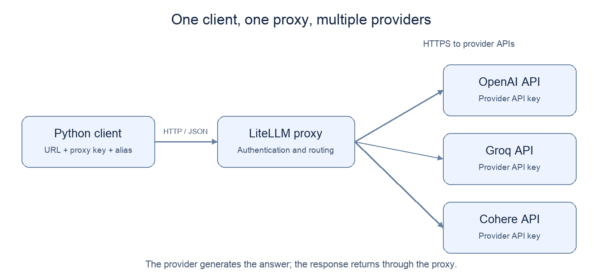
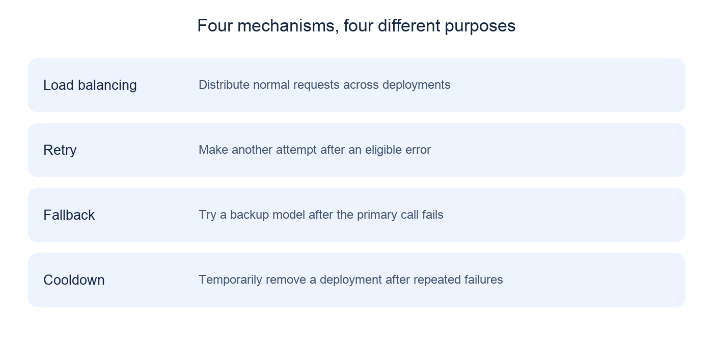

# One API, Multiple LLMs: Building a Gateway with LiteLLM

A practical guide to multi-provider access, load balancing, failure recovery, and LLM observability.

The objective of LLM-proxies is to build a shared gateway through which an application can access multiple language-model providers. Instead of configuring each provider independently in every application, the project puts model registration, authentication, routing, and observability behind a common API.

The implementation combines Python, the LiteLLM SDK and proxy server, YAML configuration, background processes, load balancing, retries, fallbacks, JSONL logging, OpenTelemetry, Langfuse, and LangChain. The goal is to understand both how these techniques work and the operational problems they address.

This article explains the architecture and the role of each technique. It also separates configuration examples from behavior that has actually been verified: provider calls have been observed, while complete routing distribution, controlled fallback recovery, and Langfuse trace delivery still require independent validation.

## Why introduce a proxy?

A direct API call is a reasonable starting point for a single provider. As an application grows, however, provider-specific integration code, credentials, quotas, and troubleshooting can become scattered across services.

A proxy provides a shared entry point. Applications send requests to one endpoint; the proxy selects the configured provider and forwards the call. Model registration and routing rules can change on the server while the client continues to use the same interface.

The practical advantages are centralized configuration, clearer credential boundaries, and a common place to apply routing and observation. The trade-off is another service to operate and another possible point of failure.

## Architecture: follow the request, then the response

The architecture has three main components: a Python client, the LiteLLM proxy, and a hosted model provider. The proxy does not generate the answer. The model running at the provider does.



The client sends a POST request to /v1/chat/completions. Its JSON body contains a model alias and the conversation. An Authorization: Bearer header carries the proxy key.

LiteLLM authenticates the request, resolves the alias using its YAML configuration, and calls the provider over HTTPS with that provider's API key. The provider returns a response to LiteLLM, which sends OpenAI-compatible JSON back to the client.

The openai Python library is an API client. Setting its base_url to the LiteLLM endpoint lets it communicate with the proxy even when the selected provider is Groq or Cohere. A common interface simplifies integration, but model capabilities still differ.

Requests in this project are synchronous: execution waits for the response. Streaming, where supported, allows the client to read response fragments progressively.

## LiteLLM SDK and proxy: two ways to integrate

LiteLLM offers a Python SDK and a proxy server. Its ecosystem supports more than 100 providers; this project focuses on examples involving OpenAI, Groq, and Cohere.

A direct SDK call uses litellm.completion() to contact a provider from Python. No local proxy server is required:

```python
from litellm import completion
response = completion(
    model="openai/gpt-4o-mini",
    messages=[{"role": "user", "content": "Explain what an LLM proxy does."}],
    temperature=0.5,
    max_tokens=200,
)
print(response.choices[0].message.content)
```

This assumes OPENAI_API_KEY has already been loaded into the environment. The provider prefix identifies the destination. For example, groq/openai/gpt-oss-120b routes through Groq even though the model identifier also contains openai/.

Cohere follows the same principle: configure COHERE_API_KEY and use a cohere/ model identifier available in the account. Cohere is an optional extension here and has not been validated end to end.

Proxy mode moves provider configuration into a separate process. This is useful when multiple clients need the same routing rules and access controls.

## Completion parameters: control the request deliberately

The messages parameter describes the conversation. Typical roles are system for general instructions, user for the request, and assistant for previous responses.

Where supported, temperature adjusts generation randomness, max_tokens bounds the generated output, and stream=True enables incremental delivery. A timeout limits waiting according to the client or SDK's timeout semantics.

These settings help control output length, responsiveness, and generation behavior. A lower temperature does not guarantee factual accuracy, and a token limit is not a word limit.

Support differs across providers and models. LiteLLM's drop_params option can remove unsupported parameters, but a removed parameter is no longer enforced. Compatibility decisions should preserve the behavior the application actually needs.

## YAML configuration and two kinds of API keys

The project separates configuration from code. The config directory contains files for basic calls, load balancing, fallback, and Langfuse observation. LiteLLM loads the file selected with --config; it does not automatically merge every YAML in the directory.

A minimal configuration exposes an alias for one model:

```yaml
model_list:
  - model_name: assistant-openai
    litellm_params:
      model: openai/gpt-4o-mini
      api_key: os.environ/OPENAI_API_KEY
general_settings:
  master_key: os.environ/LITELLM_MASTER_KEY
```

The public model_name is what the client requests. litellm_params.model identifies the actual provider and model. Environment references keep real credentials out of the YAML.

LITELLM_MASTER_KEY authenticates the client to the proxy. OPENAI_API_KEY, GROQ_API_KEY, and COHERE_API_KEY authenticate the proxy to their respective providers. These keys are not interchangeable.

The .env file holds local secrets; .venv is the Python environment directory. Both are excluded from Git. After changing .env, reload its values and restart the proxy because an existing process retains its previous environment.

## Start the proxy and communicate through one endpoint

From the project root, after installing dependencies and loading credentials, the basic proxy can be started with:

```bash
DEBUG=false DETAILED_DEBUG=false litellm --port 4000 --config config/llm.yaml
```

The basic project YAML exposes openai-gpt4o-mini. The client uses the master key and the proxy URL:

```python
import os
import openai
client = openai.OpenAI(
    api_key=os.environ["LITELLM_MASTER_KEY"],
    base_url="http://127.0.0.1:4000/v1",
)
response = client.chat.completions.create(
    model="openai-gpt4o-mini",
    messages=[{"role": "user", "content": "Explain a proxy in two sentences."}],
)
print(response.choices[0].message.content)
```

The benefit is a stable client connection. To explicitly choose among providers, declare separate aliases and change the requested model value. A loop over three aliases makes three calls; it does not combine responses or automatically run in parallel.

## Background processes in local notebooks and Colab

A server running in the foreground keeps its cell occupied. For a short Colab demonstration, nohup and & provide a compact alternative:

```python
# Run after loading credentials and creating the logs directory.
!DEBUG=false DETAILED_DEBUG=false nohup litellm --port 4000 --config config/llm-lb.yaml > logs/proxy.log 2>&1 &
!sleep 10 && tail -n 30 logs/proxy.log
```

This example assumes the project directory structure exists in the runtime and port 4000 is free. Its client must use the same port. The project's managed load-balancing section uses port 4001 instead.

Waiting ten seconds and reading a log is not a readiness check. The notebook uses subprocess.Popen() for explicit lifecycle management: poll() checks process status, terminate() requests shutdown, and wait() waits for completion. Popen creates a process, not a Python thread.

An authenticated GET /v1/models checks whether the proxy responds and exposes its aliases. It does not prove that every provider can generate successfully.

The address 127.0.0.1 refers to the machine running the client: the local computer or the remote Colab runtime. Neither Popen nor nohup preserves a server after the Colab runtime is deleted or restarted.

## Load balancing: distribute requests across deployments

Load balancing addresses limited deployment capacity, uneven load, and availability. In llm-lb.yaml, multiple deployments share global-llm: GPT-OSS 20B and 120B through Groq, plus GPT-4o mini through OpenAI.

The configuration uses simple-shuffle under router_settings.routing_strategy. A request selects a deployment; it is not automatically sent to every model for comparison. Repeated responses from the same model do not prove that routing is stuck because this strategy does not guarantee strict alternation.

RPM values describe request-per-minute capacities used by routing and limit handling. They do not increase provider quotas or establish a guaranteed spending ceiling.

Routing across different models can also change answer quality, latency, supported features, and cost. Those differences need acceptance criteria rather than an assumption that all deployments are interchangeable.

## Identify the deployment that actually answered

In this setup, response.model can retain global-llm. Raw HTTP headers provide deployment information when exposed by the proxy version:

```python
# Use a client connected to the load-balancing proxy on port 4001.
raw = client.chat.completions.with_raw_response.create(
    model="global-llm",
    messages=[{"role": "user", "content": "Reply briefly: hello."}],
)
response = raw.parse()
print(raw.headers.get("x-litellm-model-name"))
print(raw.headers.get("x-litellm-model-id"))
```

To evaluate distribution, make new requests and count selected deployments, while recording errors. Displaying the same stored response again does not exercise routing. Observed OpenAI and Groq responses demonstrate calls to those providers, not complete validation of every deployment or the distribution strategy.

## Retry, fallback, and cooldown: different recovery mechanisms

Load balancing distributes normal requests. Retry makes another attempt after an eligible error. Fallback tries a backup alias when the primary fails and the configured rule applies. Cooldown temporarily removes a deployment after repeated failures.



The fallback configuration includes retry counts, request timeouts, failure thresholds, and cooldown durations. These settings depend on error type and router version. Additional attempts can make total execution longer than a single request timeout.

A poor answer is not automatically a technical failure. A successful primary call does not test fallback either: use a controlled failure in a separate test configuration and inspect the resulting route.

In a serverless context, cooldown can help avoid repeatedly selecting an endpoint experiencing transient failures. It is separate from a function's cold start: LiteLLM's cooldown does not deploy infrastructure, stop external billing, or control a serverless function's lifecycle.

## Protect access and spending

A proxy forwarding paid requests needs access controls and consumption controls. The project's master key provides basic authentication. A shared deployment also needs consideration of application-specific keys, model restrictions, rate limits, budgets, HTTPS, and network access.

Some LiteLLM virtual-key and budget features require a database and additional configuration. They are discussed here, not deployed as part of this project.

Provider-side limits and usage monitoring remain useful. A per-response token limit does not replace an overall budget, and authentication does not automatically protect against prompt injection. Credential exposure, request abuse, and malicious prompt content are distinct concerns.

## Callbacks and JSONL logs: observe the correct process

Success and failure callbacks record events after direct SDK calls. The notebook writes one JSON object per line to success-logs.jsonl or failure-logs.jsonl. Append mode preserves previous events.

Registering callbacks does not itself make a model call. They observe the Python process where they are registered, so notebook callbacks are not automatically shared with the separately launched proxy.

Server logs help diagnose startup and request failures. For a real application, choose log fields deliberately instead of serializing all parameters blindly: credentials and sensitive conversations should not be captured unintentionally.

## Langfuse: from cloud logs to LLM tracing

Langfuse provides an interface for inspecting model activity. Setup involves creating an account and project, retrieving its public and secret keys, and configuring the host for the correct region or self-hosted deployment.

The environment uses LANGFUSE_PUBLIC_KEY, LANGFUSE_SECRET_KEY, and LANGFUSE_HOST. The current YAML uses langfuse_otel, which exports through OpenTelemetry without requiring the Python Langfuse SDK. The notebook installs the corresponding OpenTelemetry dependencies.

Observation runs on port 4002 using observation_client and logs/observation-proxy.log, avoiding conflicts with the basic proxy and load balancer.

After a test call, verify its trace in the correct Langfuse project. Depending on the integration, available data can include the model, duration, tokens, estimated cost, and errors. A log describes an event; a trace relates stages of an operation and helps explain where time was spent.

Cloud observation can transmit messages and responses outside the local machine. Select exported content, access permissions, and retention accordingly. Configuration has been prepared here; complete trace delivery still needs verification.

## LangChain: compose the workflow, keep routing in LiteLLM

The final integration connects web documents to a summary workflow. WebBaseLoader retrieves content, ChatPromptTemplate constructs the request, ChatOpenAI calls the proxy, and StrOutputParser extracts text. The | operator composes these steps.

LangChain handles orchestration. LiteLLM routes model calls. The provider performs generation. Keeping these roles separate lets the application workflow evolve independently from provider configuration.

Long documents still require context-length, cost, and error management. A simple summarization chain does not guarantee chunking or a robust retrieval pipeline. This optional integration remains to be tested in the project.

## What this project makes easier to reason about

LLM-proxies makes the request path and its configuration explicit: who authenticates whom, which deployment serves an alias, where processes run, and where call events are recorded.

Its next validation steps are to measure deployment distribution, confirm a controlled fallback, and locate a complete trace in Langfuse. These checks turn configuration into evidence of behavior. Once each section works, pinning compatible dependencies helps make the environment reproducible.

## Further reading

[LiteLLM documentation](https://docs.litellm.ai/)

[Langfuse documentation](https://langfuse.com/docs)

[Groq console](https://console.groq.com/)


## Alternative gateways and tracing tools

LiteLLM and Langfuse are choices in this project, not requirements of the architecture. The gateway routes model requests; the tracing tool records and displays activity. Either component can be replaced, provided its interfaces and integrations support the data and behavior the application needs.


### Alternatives to LiteLLM


- **Portkey AI Gateway:** a multi-provider gateway offering routing, fallback, and observability features.
- **Envoy AI Gateway:** an Envoy-based gateway worth considering for Kubernetes infrastructure.
- **OpenRouter:** a hosted service providing access to multiple models through a common API, rather than a proxy you operate yourself.
- **A custom FastAPI proxy:** useful for specific business rules, but provider adapters, authentication, routing, retries, and operational maintenance become your responsibility.


### Alternatives to Langfuse


- **LangSmith:** tracing, debugging, and evaluation for LLM applications, particularly relevant to LangChain workflows.
- **Arize Phoenix:** LLM observability and evaluation, with a self-hosting option.
- **Helicone:** observation of LLM API calls, including latency, token usage, costs, and errors depending on the integration.
- **OpenTelemetry with Jaeger or Grafana Tempo:** a general-purpose tracing approach for following activity across the entire application.

OpenTelemetry is an instrumentation and export standard, not a tracing dashboard. A backend such as Jaeger or Tempo stores and displays the traces; LLM-specific views may require additional instrumentation.

A useful next experiment would be to keep LiteLLM and compare tracing with Phoenix or LangSmith, or evaluate Portkey as an alternative gateway. Compare supported providers, routing, fallback behavior, authentication, trace content, hosting requirements, and cost. These tools have not been tested as part of this project; verify compatibility before replacing a component.


